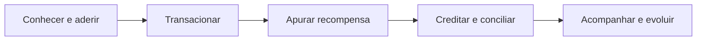

# 2. Arquitetura de negócio

[Início](../README.md) | Anterior: [Contexto](01-contexto-e-decisao.md) | Próximo: [AS-IS](03-arquitetura-atual-as-is.md)

## Problemas e subdomínios

| Subdomínio candidato | Situação | Impacto ou oportunidade a validar |
|---|---|---|
| Produtos de crédito | **Fato:** capacidades em silos e pouco reaproveitamento | Mudanças podem exigir trabalho repetido entre produtos |
| Relacionamento com cliente | **Hipótese:** dados e regras distribuídos entre produtos | Dificuldade para construir jornadas coerentes |
| Parcerias | **Proposta:** estabelecer relação com estabelecimentos e suas ofertas | Novo canal de engajamento, com dependência contratual |
| Cashback | **Proposta:** apurar e conceder recompensas | Benefícios vinculados a transações elegíveis |
| Controles e operação | **Hipótese:** controles atuais não cobrem integralmente a nova jornada | Exige conciliação, prevenção a fraude e tratamento de exceções |

## Capacidades de negócio top level

A classificação combina papel estratégico e ação inicial. Ela será revisada com o negócio, pois a diferenciação depende da estratégia do banco.

| Classificação proposta | Capacidades | Tratamento inicial |
|---|---|---|
| Diferenciadoras | Gestão de crédito, regras e ofertas de cashback | Evoluir conforme a estratégia de produto |
| Apoio compartilhado | Cliente, elegibilidade, catálogo, parcerias, notificações | Inventariar, reutilizar ou desenvolver |
| Genéricas e de controle | Identidade, segurança, prevenção a fraude, auditoria, conciliação | Avaliar soluções atuais e padronizar controles |

## Cadeia de valor

**Aderir:** apresentar oferta, condições e registrar aceite. **Transacionar:** receber transação identificada e elegível. **Apurar:** aplicar a regra vigente e registrar o benefício. **Creditar:** conceder a recompensa e conciliar valores. **Acompanhar:** disponibilizar extrato, tratar dúvidas e medir uso. Estorno e contestação atravessam o fluxo e devem obedecer às regras acordadas.

## DDD estratégico

Os contextos delimitados candidatos são **Crédito**, **Cliente**, **Parcerias** e **Cashback**. O contexto de crédito informa fatos de transação por contrato; cashback mantém suas próprias regras de benefício; parcerias administra condições comerciais. Um adaptador anticorrupção pode traduzir dados dos legados. A definição dos limites e da propriedade dos dados depende de oficinas com os times.
