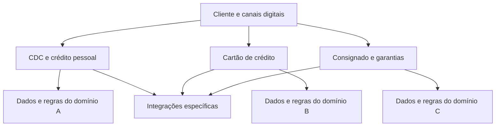

# 3. Arquitetura atual — AS-IS fictício

[Início](../README.md) | Anterior: [Negócio](02-arquitetura-de-negocio.md) | Próximo: [TO-BE](04-arquitetura-alvo-to-be.md)

> **Cenário fictício:** o case confirma apenas produtos em silos, pouco reaproveitamento e estilo de microservices. Os componentes, bases e integrações a seguir são suposições ilustrativas para sustentar a análise; precisam ser substituídos pelo inventário real.

## Visão lógica ilustrativa

Cada bloco de produto representa, **neste exemplo**, um conjunto de microservices com regras e dados próprios. A independência de dados pode ser apropriada; o problema a investigar é a duplicação de capacidades e a dificuldade de compor jornadas entre os domínios. As integrações específicas representam uma hipótese de acoplamento, não um diagnóstico confirmado.

## Problemas, evidências e consequências

| Observação | Status | Consequência a investigar |
|---|---|---|
| Produtos e capacidades foram construídos em silos | Fato do case | Baixo reaproveitamento informado no enunciado |
| Cadastro e regras comuns repetidos em cada produto | Hipótese fictícia | Divergências e esforço de manutenção |
| Eventos de transação não possuem contrato comum | Hipótese fictícia | Integração de novos parceiros pode exigir adaptações por produto |
| Conciliação e tratamento de erros variam entre produtos | Hipótese fictícia | Pode haver retrabalho ou menor rastreabilidade |
| Existência de componentes reutilizáveis | A investigar | Oportunidade de preservar e ampliar capacidades aderentes |

## Diagnóstico necessário

Inventariar serviços, contratos, responsáveis, dados e integrações. Medir falhas e tempo de mudança; entrevistar produto, tecnologia e operações. Só então classificar cada capacidade como preservar, adaptar, substituir ou criar. Não se deve concluir que toda duplicação de dados ou todo isolamento é inadequado.
