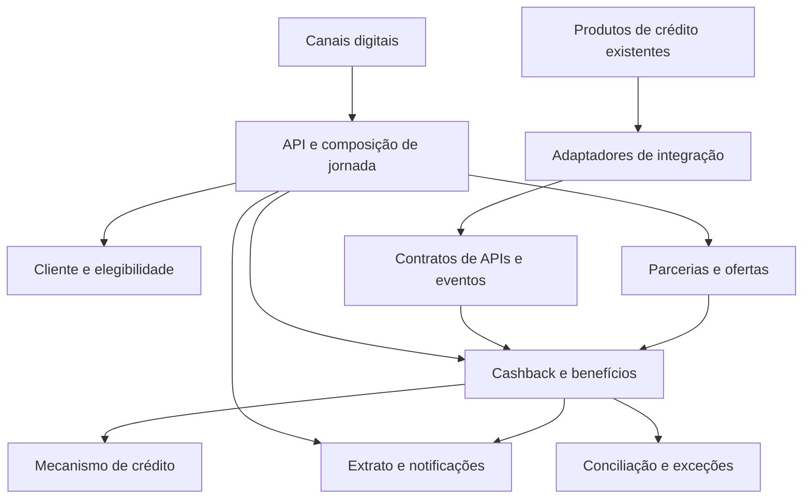
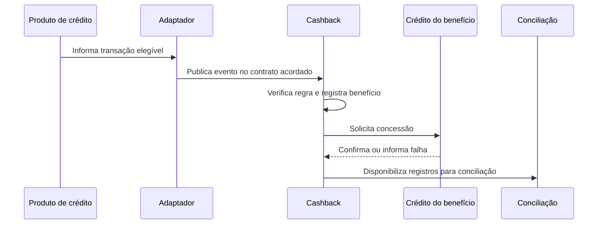

# 4. Arquitetura alvo — TO-BE proposto

[Início](../README.md) | Anterior: [AS-IS](03-arquitetura-atual-as-is.md) | Próximo: [Requisitos](05-requisitos-e-rastreabilidade.md)

## Objetivo e princípios

Habilitar cashback com parcerias e, quando comprovadamente adequado, compartilhar capacidades entre produtos sem quebrar os limites de domínio. Preservar microservices, contratos claros e autonomia de dados; evoluir de forma incremental; proteger dados e registrar operações; reutilizar componentes existentes após avaliação.

## Visão lógica de alto nível

Segurança, privacidade, auditoria, prevenção a fraude e observabilidade atendem a todos os blocos. Os blocos mostram responsabilidades lógicas, não quantidade definitiva de serviços nem produtos já existentes. O mecanismo de crédito pode ser fatura, conta existente ou outra alternativa a validar.

## Jornada e interoperabilidade

A ordem e a tecnologia de integração serão detalhadas após avaliar consistência e operação. Transações duplicadas não devem criar recompensas duplicadas; cancelamentos e estornos devem gerar tratamento correspondente. Falhas precisam ser rastreadas e reprocessadas ou encaminhadas para tratamento operacional.

## Candidatos a contextos e building blocks

| Contexto / ABB | Responsabilidade | SBB candidato, ainda não escolhido |
|---|---|---|
| Cliente e elegibilidade | Identificar cliente e verificar condições aplicáveis | Serviço existente ou serviço integrado por API |
| Parcerias e ofertas | Manter ofertas e condições de parceiros | Serviço próprio ou solução contratada |
| Cashback | Aplicar regras, registrar benefício e estorno | Microservice de recompensas com dados próprios |
| Integração | Traduzir contratos e disponibilizar eventos | Adaptadores, APIs e mensageria |
| Conciliação | Comparar transação, benefício e crédito | Componente existente ou novo, com fila de exceções |

**DDD tático:** um agregado Benefício pode manter identidade, origem, valor e estado, protegendo invariantes de cálculo e estorno. Um evento de benefício calculado poderá ser publicado após persistência confiável. Este modelo precisa ser validado com os especialistas do domínio.

## AS-IS para TO-BE

| Situação fictícia ou fato | Tratamento proposto |
|---|---|
| Silos e baixo reaproveitamento: fato | Inventariar capacidades e criar contratos de integração |
| Eventos específicos por produto: hipótese | Adaptadores convertem eventos para contrato acordado |
| Regras potencialmente repetidas: hipótese | Avaliar capacidades compartilhadas sem retirar a autonomia dos domínios |
| Processos de conciliação incertos: hipótese | Projetar conciliação e tratamento de exceções de ponta a ponta |
