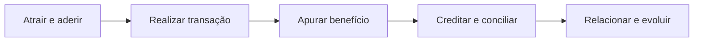
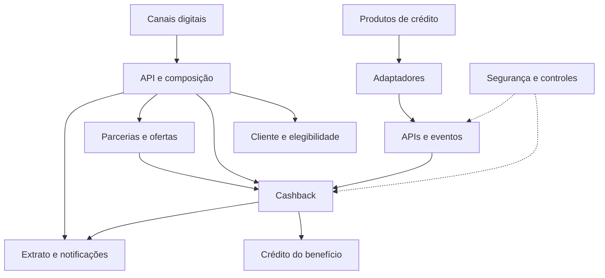
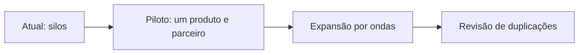

# Visão de arquitetura

## Objetivo e escopo
Elevar engajamento e melhorar o reaproveitamento entre produtos de crédito por meio de um piloto de cashback. A arquitetura preserva o estilo de microservices informado pelo case. O escopo é conceitual: inventário, dependências e maturidade dos serviços precisam de confirmação.

## Problemas e capacidades
| Subdomínio | Problema ou oportunidade | Capacidades propostas |
|---|---|---|
| Crédito | Produtos em silos, com baixo reaproveitamento | Gestão dos produtos e integração de transações |
| Relacionamento | Visão compartilhada de cliente requer diagnóstico | Cliente, consentimento e comunicação |
| Parcerias e benefícios | Nova operação de ofertas e recompensas | Parceiros, elegibilidade, cálculo, crédito e estorno |
| Gestão e controle | Evidências e controles a validar | Fraude, auditoria, conciliação e operação |

Classificação preliminar: **diferenciadoras**: regras de crédito e recompensa; **apoio compartilhado**: cliente, catálogo e integração; **genéricas/obrigatórias**: segurança e auditoria. A classificação depende da estratégia e da maturidade verificadas com o banco.

## Fluxo de valor

O cliente adere, realiza uma transação elegível e recebe o benefício segundo as regras acordadas. O banco registra e concilia a operação e comunica o resultado.

## Arquitetura alvo

Os blocos são contextos candidatos, não serviços já comprovados. O adaptador protege o novo domínio das particularidades do legado. Os contratos e os responsáveis por dados serão definidos após o levantamento. A apuração deve lidar com duplicidades, estornos e conciliação.

## Transição

A retirada de funcionalidades só ocorre após validação de equivalência, conciliação, responsabilidade operacional e plano de reversão.
